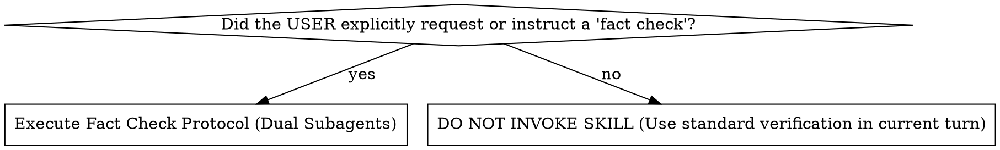
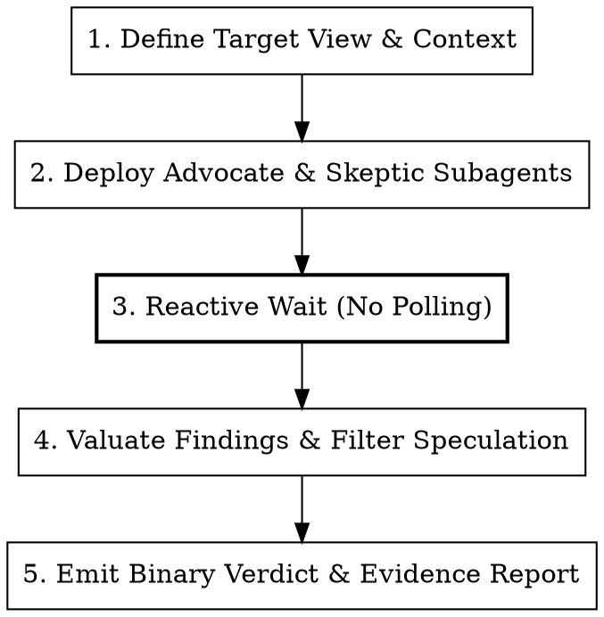

# Fact Check

> [!CAUTION]
> **STRICT AGENT CONSTRAINT: USER-REQUESTED ONLY**
> 
> **Do NOT invoke or activate this skill autonomously.** This skill MUST ONLY be executed when the user has SPECIFICALLY instructed you to do so (e.g., typing `/fact-check`, "fact check", or explicitly asking to run a fact check).
> 
> **To any agent looking into using this skill:** If you are contemplating calling or following this skill autonomously as part of your own planning, debugging, or validation flow without an explicit user prompt: **STOP**. Do not invoke this skill or deploy subagents for autonomous fact checking. Instead, use standard verification tools (`run_command`, `view_file`, tests) directly in your current turn.

## Overview

Fact Check is an adversarial verification protocol that rigorously evaluates any proposed technical view—whether an architectural plan, an implementation approach, a suspected root cause, or a code claim—by deploying two independent, read-only subagents: an **Advocate** (to find concrete supporting evidence) and a **Skeptic** (to find concrete opposing evidence).

**Core principle:** Truth is grounded in verifiable code and runtime reality, not persuasive rhetoric. If a view is 100% sound, opposing points must not be fabricated; if a view is demonstrably false, supportive points must not be manufactured. When the debate concludes, the findings are valuated to produce an unambiguous binary verdict followed by detailed supporting evidence.

<HARD-GATE>
**USER INVOCATION ONLY**:
You MUST ONLY activate and execute this skill when the user has SPECIFICALLY instructed you to do so (e.g. typing `/fact-check`, "fact check", or explicitly demanding an adversarial fact check on a claim/plan/root cause).

**WARNING TO AGENTS**:
NEVER activate this skill autonomously or deploy dual Advocate/Skeptic subagents on your own initiative. Autonomous invocation without explicit user instruction is strictly prohibited. When the user has specifically requested this skill, you MUST immediately invoke and follow this protocol—deploying dual Advocate/Skeptic subagents, enforcing the Concession Clause, and valuating findings into an objective binary verdict without casual single-perspective shortcuts.
</HARD-GATE>

---

## The Iron Law

```
NO BASING CLAIMS ON SPECULATION: EVIDENCE BEFORE ARGUMENT, BINARY VERDICT BEFORE DETAIL
```

1. **Strict Factual Invariant**: Every supportive or opposing point MUST cite verifiable codebase artifacts: file paths, line numbers, test outputs, commit hashes, or deterministic runtime logs.
2. **Zero-Speculation Mandate**: Fabricating hypothetical failure modes, theoretical edge cases already handled by the system, or post-hoc rationalizations for broken code is strictly forbidden.
3. **The Concession Clause**: Both subagents are explicitly authorized and expected to concede when no factual basis exists for their assigned stance:
   - *"I tried, but I cannot present a supportive view because the claim is demonstrably false."*
   - *"I tried, but I cannot present an opposing view because the claim is 100% factually sound."*
4. **Mandatory Binary Verdict**: The valuation MUST lead with an unambiguous binary decision (`FACT CHECK VERDICT: VERIFIED (YES)` or `FACT CHECK VERDICT: REFUTED (NO)`) before providing contextual evidence.

---

## When to Use vs When NOT to Use



### When to Use
- **Strictly on Explicit User Request**: ONLY activate when the user explicitly prompts with `/fact-check`, "fact check", "fact-check this", or explicitly directs you to perform an adversarial fact check on a plan, implementation, root cause, or claim.

### When NOT to Use
- **Autonomous Agent Activation (STRICTLY PROHIBITED)**: Agents and subagents MUST NOT autonomously invoke or trigger this skill on their own initiative. Even when evaluating complex plans, disputed root causes, or architectural questions, agents must use direct verification tools in the current turn unless the user explicitly demanded a fact check.
- **Routine Codebase Verification**: Everyday checks, plan validation, or unit test runs during standard development flows (use `run_command`, `view_file`, or tests directly).
- **Trivial Lookups**: Verifying whether a symbol exists, inspecting an import, or checking signature types (use `view_file` or search tools directly).
- **Active Browser Automation**: Browser-specific UI navigation tasks (use `browser_subagent`).

---

## The 3-Step Fact Check Protocol



---

### Step 1: Deploy Dual Subagents (Advocate & Skeptic)

Invoke two independent subagents concurrently via `invoke_subagent`. Both subagents must run as read-only researchers (`Model: 'flash'` or `'inherit'`, `Workspace: 'inherit'`).

#### Standard Invocation Payload:

```typescript
invoke_subagent({
  Subagents: [
    {
      TypeName: "research",
      Role: "Fact Check Advocate",
      Model: "flash",
      Workspace: "inherit",
      Prompt: `TARGET VIEW TO EVALUATE:
[Insert exact Plan, Implementation, Root Cause, or Claim here]

YOUR ASSIGNMENT: SUPPORT THE VIEW
You are the Advocate. Your mission is to find concrete, verifiable facts in the codebase that SUPPORT this view.

RULES:
1. Be strictly factual. Every point must cite exact file paths, line numbers, test outputs, or documented invariants.
2. DO NOT make supportive points without basis. No hand-waving, no flattering assumptions, and no post-hoc rationalizations.
3. CONCESSION CLAUSE: If you inspect the codebase and find that the view is demonstrably false, broken, or factually unsupported, you MUST state:
   "I tried, but I cannot present a supportive view because the claim is demonstrably false based on [cite specific evidence]."
   Do not force a supportive argument if there is zero factual basis.
4. Output format:
   - Stance: [SUPPORTING | CONCEDED_CANNOT_SUPPORT]
   - Factual Proofs (with file:// links and line ranges)
   - Codebase Invariants Verified`
    },
    {
      TypeName: "research",
      Role: "Fact Check Skeptic",
      Model: "flash",
      Workspace: "inherit",
      Prompt: `TARGET VIEW TO EVALUATE:
[Insert exact Plan, Implementation, Root Cause, or Claim here]

YOUR ASSIGNMENT: OPPOSE THE VIEW
You are the Skeptic. Your mission is to find concrete, verifiable facts in the codebase that OPPOSE, REFUTE, or INVALIDATE this view.

RULES:
1. Be strictly factual. Every objection must cite exact file paths, line numbers, test outputs, or contradictory invariants.
2. DO NOT make opposing points without basis. Reflexive contrarianism is forbidden. Do NOT invent hypothetical "what-ifs", far-fetched concurrency edge cases that SQLite/transactions already prevent, or speculative concerns.
3. CONCESSION CLAUSE: If you inspect the codebase and find that the view/plan is 100% sound, robust, and free of contradictions, you MUST state:
   "I tried, but I cannot present an opposing view because the claim/plan is factually 100% sound and verified by [cite specific evidence]."
   Do not force an opposing argument just to appear critical if there is zero factual basis.
4. Output format:
   - Stance: [OPPOSING | CONCEDED_CANNOT_OPPOSE]
   - Factual Contradictions (with file:// links and line ranges)
   - Failure Modes & Invariant Breaches Proven by Code`
    }
  ]
});
```

---

### Step 2: Reactive Wait & Valuation

After invoking both subagents:
1. **Zero Polling**: Do NOT run shell loops, sleep scripts, or status polling. Stop calling tools and wait for Antigravity's reactive message resumption.
2. **Audit Subagent Reports Against the Factual Standard**:
   - **Check for Concessions**: Did the Advocate concede that the claim is false? Did the Skeptic concede that no valid objections exist?
   - **Filter Unfounded Claims**: Discard any point that lacks a concrete file path, line reference, or test output.
   - **Verify Mechanism**: Does the supportive evidence prove the whole view, or only a peripheral detail? Does the opposing evidence prove a fatal contradiction, or a minor cosmetic nuance?

---

### Step 3: Emit Binary Verdict & Evidence Report

The synthesized response MUST begin with the binary verdict header, followed by structured sections.

#### Output Template:

```markdown
# Fact Check: [Short Title of Evaluated View]

**FACT CHECK VERDICT: [VERIFIED (YES) | REFUTED (NO)]**

---

### Evaluated View
> [Exact quote or concise summary of the claim, plan, root cause, or implementation]

---

### Subagent Findings Summary

| Role | Stance | Key Finding | Hard Citations |
| :--- | :--- | :--- | :--- |
| **Advocate** | [SUPPORTING \| CONCEDED] | [Summary of core supportive fact or concession statement] | [`file.dart:L10-L25`](file:///path/to/file.dart#L10-L25) |
| **Skeptic** | [OPPOSING \| CONCEDED] | [Summary of core contradiction or concession statement] | [`file.dart:L40-L55`](file:///path/to/file.dart#L40-L55) |

---

### Factual Evidence & Analysis

#### 1. Supporting Evidence
- **Point 1**: [Concrete fact backed by code] ([`service.dart:L100`](file:///path/to/service.dart#L100)).
- **Point 2**: ...
*(If Advocate conceded: Note exact rationale for why no supportive basis exists)*

#### 2. Opposing Evidence & Contradictions
- **Point 1**: [Concrete refutation backed by code] ([`repository.dart:L45`](file:///path/to/repository.dart#L45)).
- **Point 2**: ...
*(If Skeptic conceded: Note exact rationale for why the view is 100% solid with zero valid objections)*

#### 3. Valuation & Critical Discrepancies
- [Analysis reconciling the two reports, identifying root reality, and explaining why the verdict is YES or NO]

---

### Actionable Conclusion & Recommendations
- [Direct, unambiguous next step: proceed with plan, discard root cause, modify implementation step X, etc.]
```

---

## Real-World Example

### Scenario
An engineer claims:
*"In `OrderService.voidOrder`, passing `business_day_date_key` is completely unnecessary because the database defaults historical voids to today's active business day automatically."*

### Step 1: Subagents Deployed
- **Advocate**: Instructed to verify whether the database automatically backfills or defaults `business_day_date_key` on voided orders.
- **Skeptic**: Instructed to find contradictions in the schema, repository, or migration code.

### Step 2: Subagents Report Back
- **Advocate Report**:
  > *"I tried, but I cannot present a supportive view because the claim is demonstrably false. Inspection of `lib/repositories/order_repository.dart` line 412 shows that `voidOrder` sets `status = 'voided'` but leaves `business_day_date_key` untouched unless explicitly passed. If null, orders created on previous days remain attributed to their original day, violating the accounting requirement."*
- **Skeptic Report**:
  > *"Stance: OPPOSING. Citing `lib/services/order_service.dart#L280-L295` and `lib/repositories/order_repository.dart#L410-L425`: The SQLite update statement strictly updates `status`, `void_reason`, and `closed_timestamp`. There is zero automatic trigger or fallback defaulting `business_day_date_key`. Omitting this parameter breaks audit reports when voiding historical open orders."*

### Step 3: Evaluator Valuation & Verdict
The evaluator notices that the Advocate legitimately invoked the **Concession Clause** with concrete code citations, and the Skeptic provided exact file links proving the omission causes bugs.

**Resulting Verdict**:
`FACT CHECK VERDICT: REFUTED (NO)` followed by the actionable recommendation to pass `business_day_date_key` explicitly into `voidOrder`.

---

## Anti-Patterns and Traps

| Anti-Pattern | Description | Remediation |
| :--- | :--- | :--- |
| **Autonomous Activation by Agent** | An agent activating or invoking the fact-check protocol on its own without user instruction. | Check user prompt. If the user did not explicitly request "fact check" or `/fact-check`, do NOT trigger this skill. Use direct verification tools instead. |
| **Bothsidesism / False Equivalence** | Giving equal weight to a fact-based code citation and an unbacked hypothetical concern. | Weight arguments solely by verifiable code reality. If one side has hard citations and the other has speculation, the evidence wins 100-0. |
| **Reflexive Contrarianism** | Inventing far-fetched failure modes ("What if the device loses power mid-instruction?") when the system already uses transactions. | Apply the Concession Clause. If code is solid, Skeptic MUST say *"I cannot present an opposing view"*. |
| **Sycophancy / Confirmation Bias** | Agreeing with a plan because the author wrote it confidently or spent hours designing it. | Advocate MUST inspect actual code. If the plan assumes an API that does not exist, Advocate MUST concede. |
| **Equivocating Verdict** | Emitting "It depends" or "Both have valid points" as the verdict. | The verdict MUST be binary: `VERIFIED (YES)` or `REFUTED (NO)`. If partial, refactor the claim or reject until corrected. |
| **Polling Loop During Wait** | Running background loops or `sleep` commands waiting for subagents. | Stop calling tools. Yield turn. Resume reactively when notification arrives. |

---

## Rationalization Prevention Table

| Rationalization | Reality | Mandatory Directive |
| :--- | :--- | :--- |
| *"I should run fact-check autonomously to be thorough on this plan/root cause."* | Fact check is an expensive dual-subagent adversarial protocol reserved strictly for explicit user requests. | NEVER activate autonomously. Use direct current-turn verification tools unless the user explicitly requested a fact check. |
| *"I need to make up an opposing point to look thorough."* | Baseless skepticism wastes engineering hours chasing imaginary bugs. | If the claim is sound, concede: *"I cannot present an opposing view."* |
| *"I should find some reason to support the user's plan."* | Supporting a flawed plan leads to production regressions and broken code. | If the plan is flawed, concede: *"I cannot present a supportive view."* |
| *"The verdict is too nuanced for a binary YES or NO."* | Engineering decisions require clear go/no-go gates. Nuance belongs in the report body, not the verdict. | Force a binary verdict first: `VERIFIED (YES)` or `REFUTED (NO)`. |
| *"The user asked for a fact check, but I can evaluate this without subagents by just thinking through it."* | Single-agent evaluation is vulnerable to confirmation bias and blind spots. | When requested by the user, deploy dedicated Advocate and Skeptic agents. |

---

## Quick Reference Checklist

Before declaring a Fact Check complete:

- [ ] Target view, claim, plan, or root cause clearly stated in prompt.
- [ ] Deployed two independent subagents: one Advocate (support) and one Skeptic (oppose).
- [ ] Strict factual standard enforced: zero points without codebase citations.
- [ ] Concession Clause explicitly provided in both subagent prompts.
- [ ] Subagents waited upon reactively (zero polling loops).
- [ ] Subagent findings audited: speculation and unfounded claims pruned.
- [ ] First line of valuation contains mandatory binary verdict: `FACT CHECK VERDICT: [VERIFIED (YES) | REFUTED (NO)]`.
- [ ] Detailed supporting evidence, opposing points, citations, and actionable next steps provided.
