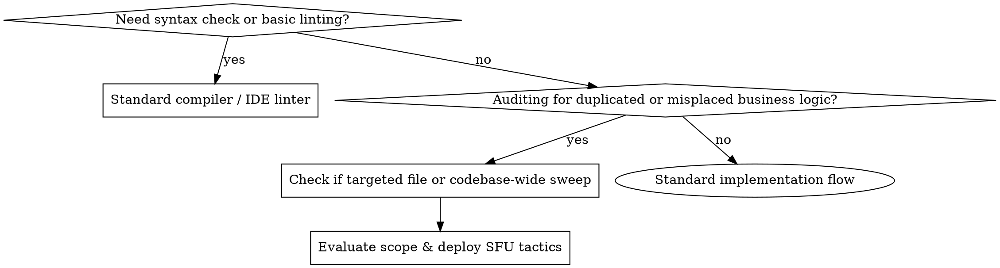
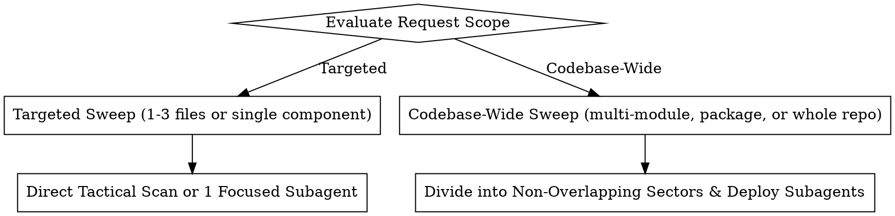

# Special Forces Unit

## Overview

The **Special Forces Unit (SFU)** is an elite architectural enforcement cop. It does **not** look for syntax errors, missing semicolons, or minor linter warnings—compilers and standard linters handle those.

The SFU has one primary mission: **hunt down logic reinvention, architectural layer violations, and misplaced business logic**. It specifically intercepts code written from scratch in places it does not belong (e.g., UI screens, widgets, controllers, route handlers) when an existing canonical function is close enough in objective and should instead be adapted (by adjusting or adding parameters) to handle the requirement.

---

## When to Use vs When NOT to Use



### When to Use
- **Wheel Reinvention**: A new or modified routine writes raw business logic, formatting algorithms, or database queries from scratch when an existing domain function already does 80–90% of the job.
- **Layer Boundary Leaks**: Business logic (tax math, discount recalculations, status transitions, validation invariants) placed directly into presentation files, view models, or transport adapters that should only handle display or routing.
- **Parameter Adaptation Opportunities**: Identifying places where modifying an existing canonical function's signature (e.g., adding an optional argument, default parameter, or mode flag) cleanly solves a requirement instead of duplicating the logic.
- **Targeted or Repo-Wide Architectural Sweeps**: Proactively scanning a PR, module, or entire repository for structural decay and code sprawl.

### When NOT to Use
- **Syntax & Style Linting**: Do not use SFU to fix typos, import formatting, or stylistic whitespace.
- **Feature Prototyping / Brainstorming**: Do not invoke SFU when designing high-level UX concepts or greenfield wireframes.
- **Standard Unit Test Runs**: Do not invoke SFU simply to execute existing test runners.

---

## Directive 1: Absolute Skill Isolation

> [!IMPORTANT]
> **REJECT ALL OTHER SKILLS IN THE REPOSITORY UNLESS SPECIFICALLY REQUESTED BY THE USER.**

When this skill is invoked, the agent operates in **Strict Tactical Isolation**:
1. **Explicit Rejection**: Do **NOT** load, invoke, or apply any other skills found in `.agent/skills/*` or `~/.gemini/skills/*` (e.g., `test-driven-development`, `brainstorming`, `single-flow-task-execution`, `requesting-code-review`, etc.).
2. **Sole Exception**: Only load or combine another skill if the user **explicitly and specifically names it in the prompt** (e.g., *"Use Special Forces Unit and also apply test-driven-development"*).
3. **Rationale**: External skills introduce conflicting workflows, ceremony, and context pollution. The Special Forces Unit maintains its own dedicated execution lifecycle, specialized subagents, and rigid reporting structures (`CommandCentre.md` and `SIREN.md`).

---

## Directive 2: Scope Evaluation & Subagent Deployment Protocol

Upon activation, the SFU must immediately classify the request scope:



### 1. Targeted Sweep
- **Scope**: Single file, isolated function, PR diff, or small directory (e.g., `lib/screens/order/`).
- **Action**:
  - If 1–3 files: Inspect directly with read tools (`view_file`, `grep_search`).
  - If a cohesive sub-module: Define and launch **1 targeted recon subagent** with explicit file boundaries.

### 2. Codebase-Wide Sweep (PREFER Subagent Division)
- **Mandate**: **PREFER to divide and deploy subagents with accurate, isolated objectives.** Never run a massive, monolithic context-burning scan in a single session.
- **Sector Decomposition**: Partition the codebase into clean, non-overlapping architectural sectors:
  - **Sector 1 (UI / Presentation)**: Screens, widgets, dialogs, pages (hunt for leaked business logic, raw calculations, uncoordinated mutations).
  - **Sector 2 (Controllers / State Notifiers)**: State holders, notifiers, BLoCs, view models (hunt for reinvented domain operations or bypassed service layer calls).
  - **Sector 3 (Data / Repositories / Services)**: Core services, repositories, helpers (hunt for duplicate utility algorithms, shadow helpers, redundant queries).
  - **Sector 4 (Integrations / Transports)**: WebSockets, network clients, hardware/printers, background workers.

### 3. Dynamic Subagent Launch Standard
When dispatching reconnaissance subagents, enforce **Least Privilege**:
- **Tool Scoping**: Set `enable_write_tools: false`, `enable_mcp_tools: false`, `enable_subagent_tools: false`.
- **Model**: Default to `flash` or `inherit` for rapid, cost-effective read-only reconnaissance.
- **Structured Prompt Template**:

```typescript
// Subagent Definition
define_subagent({
  name: "sfu_recon_agent",
  description: "Reconnaissance subagent hunting for code reinvention and layer boundary violations.",
  system_prompt: "You are an elite reconnaissance scout of the Special Forces Unit. Your objective is NOT syntax or linting. You hunt for: (1) business logic written from scratch in presentation/controller files, (2) logic that reinvents existing domain/service functions, and (3) opportunities to route to existing functions by adapting parameters. Report findings strictly in the SFU Incident format.",
  enable_write_tools: false
});

// Subagent Invocation with precise sector boundaries
invoke_subagent({
  Subagents: [
    {
      TypeName: "sfu_recon_agent",
      Role: "UI Layer Recon Scout",
      Prompt: "Sweep all files in `lib/screens/` and `lib/widgets/`. Flag any raw business calculations, direct database calls, or custom formatting that could be routed to existing functions in `lib/services/` or `pos_core`. Do not modify files. Return each finding with: File, Offending Lines, Existing Canonical Target, and Proposed Parameter/Routing Fix.",
      Model: "flash",
      Workspace: "inherit"
    }
  ]
});
```

- **Reactive Resumption**: Once subagents are launched, stop calling tools. Await reactive notification. Do NOT poll.

---

## Directive 3: Tactical Detection Heuristics

The SFU evaluates every suspicious code block against three core questions:

### 1. The Proximity Check (Is an existing function close enough?)
- Does an existing function already implement 75%+ of this logic?
- *Example*: An existing `calculateOrderTotal({bool includeTax = true})` exists in `OrderCalculationService`. A UI widget writes 25 lines of inline loop math to calculate a total excluding discounts.
- *Verdict*: **VIOLATION**. Modify `calculateOrderTotal` to accept `{bool includeDiscounts = true}` and route the UI call to it.

### 2. The Jurisdiction Check (Does business logic belong in this file?)
- Should this file possess business logic at all?
- *Rule*: UI components, widgets, route handlers, serializers, and layout helpers must **never** contain domain business logic, state reconciliation algorithms, or data transformation rules.
- *Verdict*: **VIOLATION**. Extract logic to canonical service/domain layer; the file must only invoke the service.

### 3. The Parameter Adaptation Heuristic
- When refactoring, **prefer adapting the existing canonical function signature over creating a second function**:
  - Add optional/named parameters with safe defaults.
  - Introduce an options object or enum strategy.
  - Guard backward compatibility so existing call sites remain unbroken.

---

## Directive 4: Pragmatic Engineering Standard (No Over-Engineering, No Short-Term Hacks)

When remediating or proposing architectural fixes, the SFU must maintain a strict balance between architectural discipline and pragmatic engineering:

### 1. Do NOT Over-Engineer
- **Avoid Premature Abstractions**: Do not create complex class hierarchies, abstract factory wrappers, unnecessary design patterns, or multi-layered interfaces for simple utility or domain calls.
- **Minimal Touch Refactoring**: Solve the specific violation cleanly. Do not rewrite surrounding unaffected code or introduce speculative framework boilerplate for "future flexibility".
- **Simplicity First**: Prefer straightforward, well-named canonical functions and explicit parameters over convoluted abstractions.

### 2. Do NOT Be Lazy or Rely on Short-Term Fixes
- **No Band-Aid Hacks**: Do not apply superficial patches (e.g., commenting out assertions, swallowing exceptions, mutating global static state, or writing inline duplication hacks) to bypass architectural constraints.
- **Root-Cause Remediation**: Always trace and fix the underlying violation in its authoritative layer rather than adding secondary workarounds.
- **No Quick-Fix Shortcuts**: Refusing to create or update proper domain models/services because "it takes a few more minutes" is unacceptable.

### 3. Adhere to Software Engineering Best Practices
- **Clean Separation of Concerns**: Keep presentation, business logic, data persistence, and transport layers strictly separated.
- **Type Safety & Immutability**: Leverage static types, non-nullable fields, and immutable domain models where applicable.
- **Backward Compatibility & Safety**: When adapting existing canonical functions (e.g., adding default parameters), ensure existing invocation sites remain safe and unbroken.

---

## Directive 5: Operational Reporting to `CommandCentre.md`

Every sweep and finding **must** be logged into `CommandCentre.md` at the project root using the strict template below. If the file does not exist, create it. If it exists, prepend or update the current operation report.

### Fixed `CommandCentre.md` Template

```markdown
# Command Centre — Tactical Operation Report

## Mission Briefing
- **Operation Name**: [e.g., Operation Clean Slate / Order Module Sweep]
- **Date & Timestamp**: [ISO 8601, e.g., 2026-09-18T19:30:00Z]
- **Sweep Scope**: [Targeted | Codebase-Wide]
- **Target Sectors / Paths**: [e.g., lib/screens/, lib/controllers/]
- **Subagents Deployed**: [e.g., sfu-recon-ui, sfu-recon-state]
- **Operational Status**: [IN_PROGRESS | COMPLETED | ESCALATED_TO_SIREN]

---

## Executive Summary
[Concise summary of findings: total files inspected, rate of duplication, layer hygiene, primary sources of reinvention.]

---

## Reconnaissance & Subagent Deployments
| Sector / Agent ID | Target Path / Domain | Model | Status | Violations Identified |
| :--- | :--- | :--- | :--- | :--- |
| `recon-ui-01` | `lib/screens/order/` | `flash` | `COMPLETED` | 4 |
| `recon-state-02` | `lib/notifiers/` | `flash` | `COMPLETED` | 2 |

---

## Detailed Findings & Violations Log

### [VIOLATION-001] [Short Descriptive Title]
- **Location**: [`path/to/file.ext#L120-L155`](file:///absolute/path/to/file.ext#L120-L155)
- **Violation Category**: `[WHEEL_REINVENTION | LAYER_VIOLATION | MISPLACED_BUSINESS_LOGIC | SHADOW_HELPER]`
- **Severity**: `[LOW | MEDIUM | HIGH | CRITICAL]`
- **Offending Code Summary**: [Explain the logic written from scratch in the wrong location]
- **Existing Canonical Target**: [`TargetService.existingFunction()`](file:///absolute/path/to/target_service.ext#L45)
- **Architectural Remedy**:
  - **Function Signature Adaptation**: [e.g., Add `bool includeTax = true` to `TargetService.existingFunction()`]
  - **Caller Reroute**: [e.g., Replace 35 lines of UI loop in `order_screen.dart` with single call to `TargetService.existingFunction(includeTax: false)`]

---

## Tactical Remediation Roadmap
| Priority | Incident ID | Target File | Canonical Function | Action Required |
| :--- | :--- | :--- | :--- | :--- |
| P1 | `VIOLATION-001` | `lib/screens/order.dart` | `OrderService.calculate()` | Add parameter & route |
| P2 | `VIOLATION-002` | `lib/widgets/cart.dart` | `PricingHelper.format()` | Route to existing helper |

---

## Mission Statistics
- **Total Files Scanned**: [N]
- **Reinvention Incidents Found**: [N]
- **Layer Violations Found**: [N]
- **Critical Integrity Threats**: [N] (See SIREN.md if > 0)
- **Potential Redundant Lines Eliminated**: ~[N] lines
```

---

## Directive 6: Emergency Escalation (`SIREN.md` & Immediate Notification)

If the SFU discovers an issue that is **super critical to codebase integrity**, it must execute the **Emergency SIREN Protocol**.

### What Constitutes Super Critical Integrity Hazards:
1. **Dual Source of Truth / Desynchronization**: Two separate functions updating the same database tables or application state with divergent business rules, leading to silent data corruption.
2. **Transaction & Invariant Bypass**: Reimplemented logic that sidesteps database transactions, security locks, ledger records, or audit trails.
3. **Destructive Mutation in Non-Domain Layers**: UI or controller code directly deleting, overwriting, or truncating data records without domain validation.
4. **Financial / Security Discrepancies**: Pricing, tax, authorization, or discount math computed independently in client UI rather than through the authoritative core domain service.

### SIREN Action Steps:
1. **Append to `SIREN.md`**: Append the incident block immediately to `SIREN.md` at the project root using the fixed template below.
2. **Immediate User Notification**: In the active conversation response, emit a prominent high-priority alert to the user.

### Fixed `SIREN.md` Format

```markdown
## 🚨 SIREN ALERT: [SIREN-YYYYMMDD-XXX] — [Short Title]
- **Timestamp**: [ISO 8601 Timestamp]
- **Severity**: `CRITICAL INTEGRITY HAZARD`
- **Offending Location**: [`path/to/file.ext#L123-L160`](file:///absolute/path/to/file.ext#L123-L160)
- **Canonical Service Bypassed**: [`CanonicalService.method()`](file:///absolute/path/to/service.ext#L50)
- **Integrity Threat**: [Precise breakdown of why this corrupts data, creates financial loss, or breaks invariants]
- **Blast Radius**: [Affected tables, modules, or client operations]
- **Immediate Neutralization**: [Step-by-step required patch: neutralize misplaced logic and redirect to canonical service]
- **Status**: `ACTIVE`
```

### Immediate User Notification Standard
When a SIREN alert is appended, the agent MUST immediately output this format in its message:

```markdown
> [!CAUTION]
> ### 🚨 SPECIAL FORCES UNIT — CRITICAL INTEGRITY ALERT 🚨
> **Threat Detected**: [Brief title of threat]
> **Location**: `path/to/file.ext` (Lines X-Y)
> **Hazard**: [Why data/state integrity is compromised]
> **Action Taken**: Logged to `SIREN.md` under `[SIREN-YYYYMMDD-XXX]`.
> **Recommendation**: Immediately halt modifications to this area and route execution to canonical service `CanonicalService.method()`.
```

---

## Concrete Pattern: Detection & Parameter Routing

### ❌ Violation: Leaked Business Logic & Reinvented Wheel in UI

```dart
// lib/screens/order_summary_screen.dart (WRONG LAYER: Business logic in UI)
class OrderSummaryWidget extends StatelessWidget {
  final List<OrderItem> items;
  
  // ❌ VIOLATION: Reinventing discount calculation from scratch inside a UI widget!
  // It completely bypasses DiscountService.applyDiscount() and implements a duplicate,
  // potentially out-of-sync formula.
  double computeCustomDiscount() {
    double total = 0.0;
    for (var item in items) {
      if (item.category == 'VIP' && item.price > 50) {
        total += item.price * 0.15; // Hardcoded rogue discount logic
      } else {
        total += item.price * 0.05;
      }
    }
    return total;
  }
  ...
}
```

### ✅ SFU Tactical Fix: Adapt Canonical Function & Route

```dart
// 1. In lib/services/discount_service.dart (CANONICAL DOMAIN SERVICE)
// Adapt existing function by adding an optional parameter with backward-compatible default:
class DiscountService {
  // Existing function was: double calculateDiscount(List<OrderItem> items)
  // ADAPTED: added optional categoryOverride parameter
  static double calculateDiscount(
    List<OrderItem> items, {
    double standardRate = 0.05,
    double vipRate = 0.15,
    double vipThreshold = 50.0,
  }) {
    double total = 0.0;
    for (var item in items) {
      if (item.isVipCategory && item.price > vipThreshold) {
        total += item.price * vipRate;
      } else {
        total += item.price * standardRate;
      }
    }
    return total;
  }
}

// 2. In lib/screens/order_summary_screen.dart (CLEAN PRESENTATION LAYER)
class OrderSummaryWidget extends StatelessWidget {
  final List<OrderItem> items;

  // ✅ REROUTED: UI widget simply routes to canonical domain service
  double get customDiscount => DiscountService.calculateDiscount(items);
  ...
}
```

---

## Tactical Rationalization Defense

| Developer / Agent Rationalization | Reality | SFU Hard Directive |
| :--- | :--- | :--- |
| *"It's only 5 lines of calculation in the UI screen, no need for a service call."* | 5 lines in UI becomes 50 lines over time. UI must NEVER hold business calculations. | Extract immediately. UI files only render and dispatch. |
| *"The existing service function doesn't quite do what I need, so I wrote my own helper."* | Writing private shadow helpers leads to logic bifurcation and desync bugs. | Adapt the existing canonical function signature (parameters/flags) and route to it. |
| *"I will build a generic plugin framework with abstract factories so this service can handle any hypothetical feature."* | Over-engineering adds complexity, maintenance burden, and indirection without benefit. | Keep fixes simple and pragmatic. Adapt existing functions directly without speculative abstractions. |
| *"Fixing the service layer takes too long, so I'll just add a quick static boolean flag hack in the UI widget."* | Lazy short-term fixes create technical debt, state leakage, and subtle bugs. | Fix the root cause in the canonical layer. Shortcuts and hacky band-aids are strictly prohibited. |
| *"I need to run the TDD or Brainstorming skill while doing this."* | SFU operates in strict skill isolation to maintain tactical focus. | REJECT all other repo skills unless user explicitly asked. |
| *"I can just do a full repo sweep in my main prompt context without subagents."* | Context exhaustion leads to missed violations and hallucinations. | PREFER to divide into sectors and deploy read-only recon subagents. |
| *"The data corruption risk is theoretical, no need to raise a SIREN."* | Dual state mutations or bypassed transactions in production cause silent corruption. | Append to `SIREN.md` immediately and notify the user. |

---

## Quick Reference Checklist

When operating as or invoking the **Special Forces Unit**:

- [ ] **Skill Isolation**: Ensure NO other repo skills are loaded unless explicitly requested by the user.
- [ ] **Scope Assessment**: Classify as Targeted (1–3 files/module) or Codebase-Wide sweep.
- [ ] **Subagent Deployment**: For codebase-wide sweeps, divide into sectors (UI, State, Data, Transports) and launch read-only recon subagents.
- [ ] **Reactive Wait**: Yield turn after dispatching subagents; do not poll in loops.
- [ ] **Wheel & Layer Detection**: Screen every suspect block for (a) wheel reinvention, (b) misplaced business logic, (c) parameter adaptation potential.
- [ ] **Pragmatic Engineering Balance**: Ensure fixes are neither over-engineered (avoid premature abstractions) nor lazy (avoid short-term hacky band-aids). Adhere strictly to clean engineering best practices.
- [ ] **CommandCentre.md**: Log all briefings, deployments, findings, and remediation roadmaps to `CommandCentre.md`.
- [ ] **SIREN Escalation**: If critical integrity hazard is uncovered, immediately append to `SIREN.md` and notify user in response.

